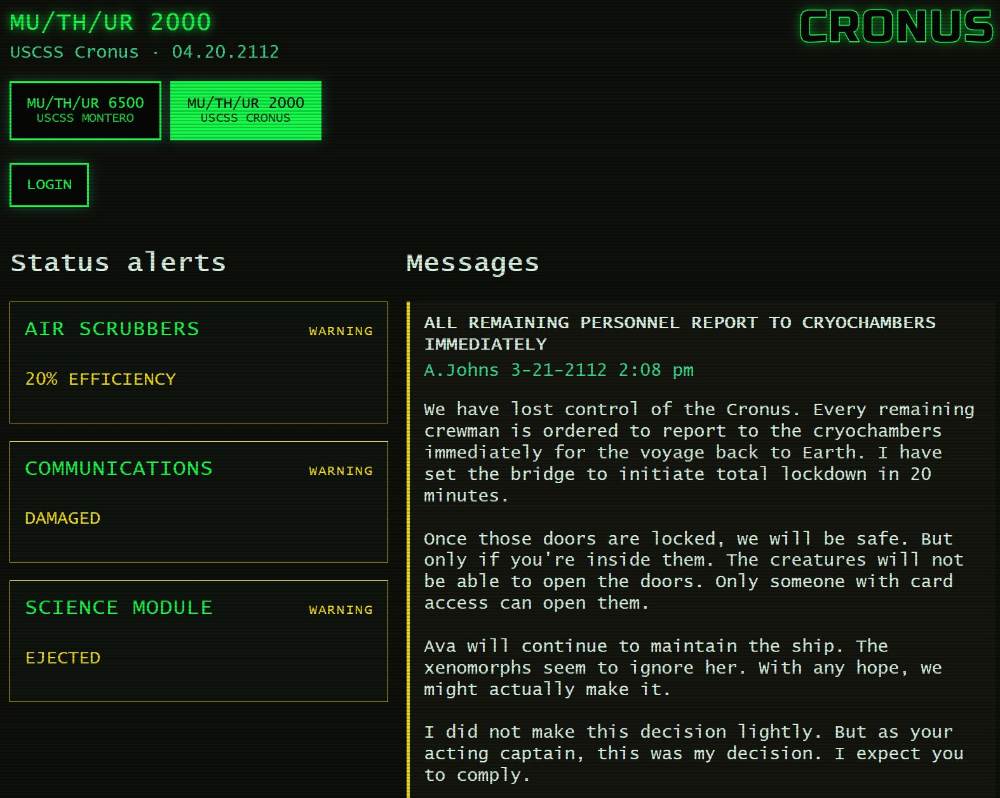
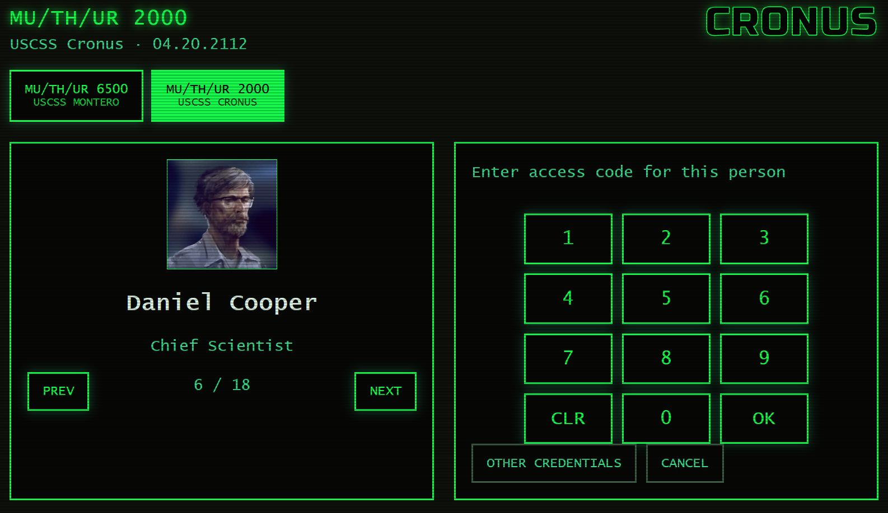
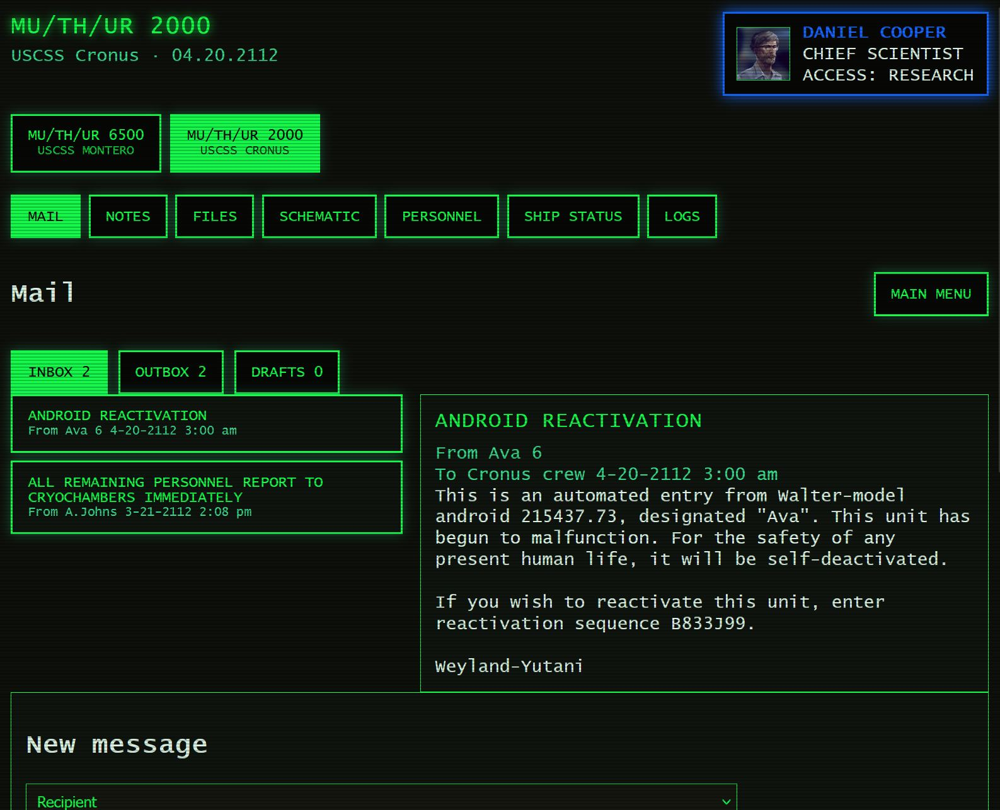
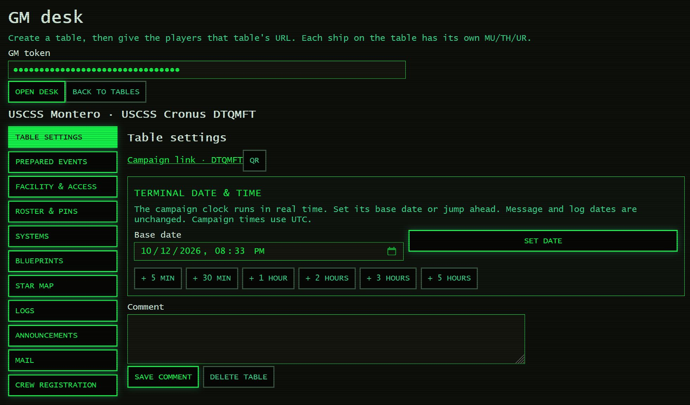
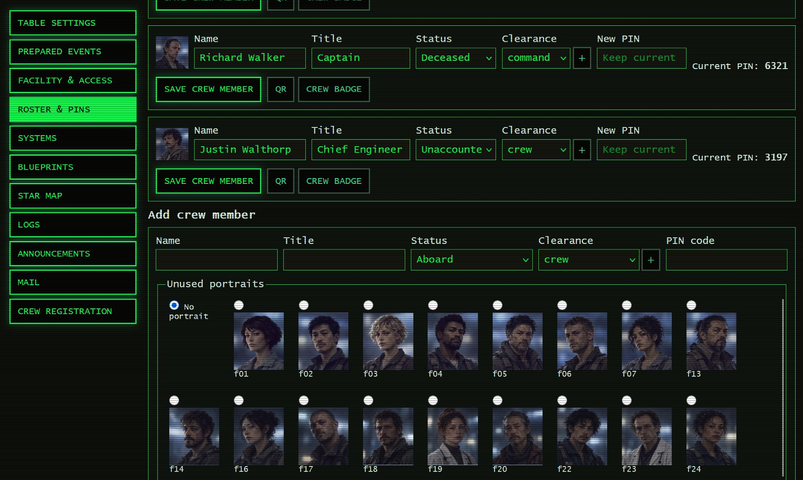
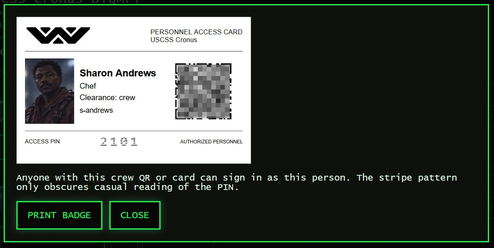
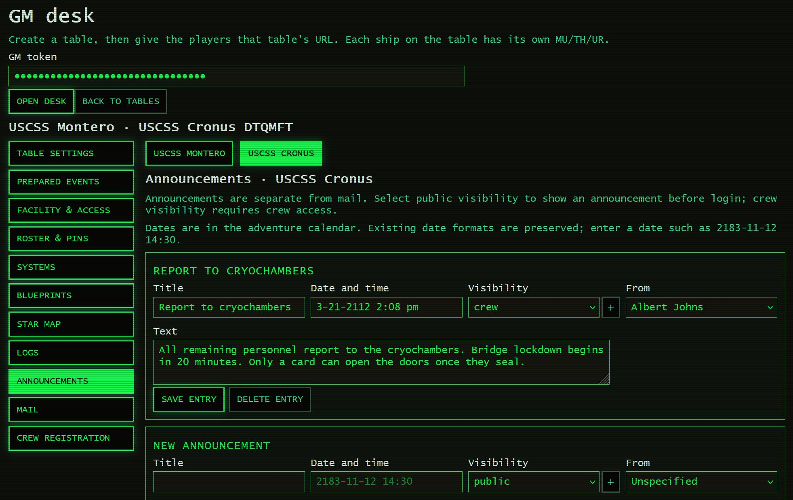
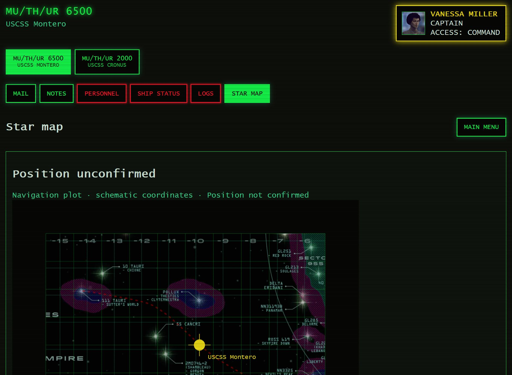

# What it is

An interactive MU/TH/UR terminal for the **ALIEN Roleplaying Game**, built around **Chariot of the Gods**. Players use crew PINs or access-card QR codes to read mail, browse personnel and explore facility records. The GM controls the campaign through a separate desk. The green-screen interface works on phones, tablets and desktops.

Original sources:

- [DapperDaveW's original terminal on Experimental Gamer](https://www.experimentalgamer.com/AlienRPG/ChariotOfTheGods/Terminal/)
- [MaciejLisCK's upstream repository](https://github.com/MaciejLisCK/Alien-RPG-Chariot-of-the-Gods-Terminal)



## Features added in this fork

Compared with upstream [`main` at `fff6cf5`](https://github.com/MaciejLisCK/Alien-RPG-Chariot-of-the-Gods-Terminal/commit/fff6cf5bd2f72cb3aba9bd5ceb5f489665c55ce7), this fork turns the original static terminal into a Vue application with a Node.js/Fastify backend and persistent SQLite storage. It retains the original mail, maps and supporting material, with the additions below.

### Player terminal

- Responsive views, facility/AI branding, crew portraits and clearance-based navigation.
- Public alerts and transmissions, a crew rolodex and numeric PIN login.
- Personal inbox, outbox, drafts, message composition and station notes. Users see their own mailbox, including permitted broadcasts.
- Interactive deck blueprints, personnel, systems, logs and clearance-based files.
- Live updates approximately every five seconds, including roster and PIN changes on the login screen.



<details>
<summary>Player mailbox</summary>



</details>

### Campaign tables and facilities

- Independent tables with six-character codes, persistent state and shareable campaign links.
- Pre-entered scenario data for Cronus, Montero and Astraeus, plus a combined Chariot of the Gods preset. The Montero crew's scenario details and company access are ready to use.
- A GM table list and a separate editor with a section sidebar and compact controls.
- **Facility & access** supports Ships, Bases, Space Stations and Offices. Edit the facility name, AI name/version, home base and player access.
- An editable campaign clock with manual date entry and jumps of 5/30 minutes or 1/2/3/5 hours. Banners use the campaign clock; existing message and log dates remain unchanged.



### Crew, credentials and registration

- Edit crew names, titles, statuses, clearances and PINs, or add people with unused portraits. Default crew PINs are pre-entered.
- View current PINs in the authenticated GM roster. Login uses hashes; new PIN changes are also encrypted so the GM can retrieve them later.
- **GM-only crew registration** at another facility. Personal mail and notes are shared across facilities where that person is registered; they are not copied or moved. Facility broadcasts, logs, systems, blueprints and ship files stay local.
- **Eight-digit company overrides** grant company-level access to another AI without crew registration or private personal mail, notes or files. The GM controls the code and target; changing the code, target or clearance revokes the old remote session.



### QR codes and crew badges

Campaign and crew links have QR pop-ups. The badge creator produces printable white personnel cards with a portrait, name, title, clearance, login QR and a striped PIN.

QR codes are generated locally. A crew QR grants that person's access to anyone holding it; the printed PIN pattern obscures casual reading but is not encryption.



### Adventure management

- Create, edit and remove system statuses, with suggested system names, adventure presets, visibility, severity and clearance-specific descriptions.
- Edit existing or new logs, announcements and mail, including their dates and visibility. Mail filters support sender, recipient and text searches.
- Prepare events before play: combine transmissions, log entries, system changes and roster changes, then push the whole event in one action. Failed changes leave the event unapplied.
- Announcements and mail have separate editors; public visibility and broadcast recipients control their appearance on the terminal.



### Blueprints and navigation

- Edit overview/deck images by clearance, deck dimensions, room hotspots and descriptions.
- Use repository images, HTTPS image URLs or GM-authenticated uploads for deck plans and star-map backgrounds. PNG, JPEG and WebP uploads are decoded and re-encoded on the server, stripped of metadata and limited in size and dimensions. SVG and executable uploads are rejected.

- A command/company Star map with location presets, editable waypoints, ship position and navigation notes. The map uses schematic coordinates.
- Legacy Astraeus media and puzzle scripts are retained as scenario material. The current terminal lists tasks but does not execute those legacy procedures.

# Run

Install **Node.js 24**, then run:

```sh
npm ci
npm run build
```

Copy `.env.example` to `.env` in the repository root and set:

```dotenv
PORT=3000
DATA_DIR=./var
GM_TOKEN=replace_with_a_long_random_secret
```

`.env` is gitignored. Choose a long, random `GM_TOKEN` and keep it private. Start the server with that file:

```sh
node --env-file=.env server.js
```

Open `http://localhost:3000/?gm`, enter the same GM token, create a table and share its campaign link with your players. No database service or manual database creation is needed: Node's built-in SQLite support creates `DATA_DIR/app.sqlite` automatically.

For frontend development, keep the backend running and run `npm run dev` in another terminal. Run `npm test` for the automated checks.

For deployment, nginx can reverse-proxy the Node server using standard HTTPS and security best practices. If hosting under a URL prefix, set `BASE_PATH`, for example `/tools/alien-terminal/`, and preserve that prefix through the proxy.

Back up the whole `DATA_DIR`, including the database, `gm-pin.key` and `uploads/`. The key is needed to recover encrypted PIN changes. Default PINs are in `gm/<ship>/pins.json`; an older custom PIN stored only as a hash needs a replacement if its value was not recorded elsewhere. Existing table edits are preserved when scenario defaults change.

# Languages

This fork is currently in English. Upstream also maintains [Polish](https://github.com/MaciejLisCK/Alien-RPG-Chariot-of-the-Gods-Terminal/tree/feature/polish-language) and [German](https://github.com/MaciejLisCK/Alien-RPG-Chariot-of-the-Gods-Terminal/tree/feature/german-language) branches; those translations apply to the upstream terminal.

# History and credits

## DapperDaveW's original game aid

**[DapperDaveW](https://www.reddit.com/user/DapperDaveW/)** wrote the [Cronus crew email supplement](https://www.reddit.com/r/alienrpg/comments/se3w5x/spoiler_chariot_of_the_gods_crew_emails_supplement/) for Chariot of the Gods, expanding the crew's relationships and events through fictional correspondence.

The subsequent JavaScript/CSS terminal was hosted on [Experimental Gamer](https://www.experimentalgamer.com/AlienRPG/ChariotOfTheGods/Terminal/). The [original r/alienrpg announcement](https://www.reddit.com/r/alienrpg/comments/seyrii/spoiler_chariot_of_the_gods_cronus_crew_access/) described players finding crew access cards, scanning their QR codes and reading that person's mail on a phone or shared computer representing an in-game terminal.

The GM decided where cards would appear in the adventure. DapperDaveW also outlined plans for security maps, research records, command information and company material. Credit for the original writing, access-card concept and terminal presentation belongs to DapperDaveW; the post's adventure interpretations remain their original contribution.

## MaciejLisCK's repository

**[MaciejLisCK](https://github.com/MaciejLisCK)** preserved and adapted the hosted terminal in the [upstream repository](https://github.com/MaciejLisCK/Alien-RPG-Chariot-of-the-Gods-Terminal), making it available as a static site with crew access links, maps, pictures, sounds and translated branches. Credit for that adaptation and subsequent upstream improvements belongs to MaciejLisCK and the upstream contributors.

Upstream noted that its copy could differ from the original website because some content and scripts were difficult to download. This fork inherits that preservation history; inherited material is not claimed as new work by this fork.

## This fork

**[pgotsis/Alien-RPG-Chariot-of-the-Gods-Terminal](https://github.com/pgotsis/Alien-RPG-Chariot-of-the-Gods-Terminal)** continues the project as a persistent, GM-managed application with the features described above.

The **ALIEN Roleplaying Game** and **Chariot of the Gods** are published by [Free League Publishing](https://freeleaguepublishing.com/) under license for the ALIEN setting. Credit for the setting and adventure remains with their creators and rights holders. This repository is a fan-made game aid built on those works and the community contributions credited here.
